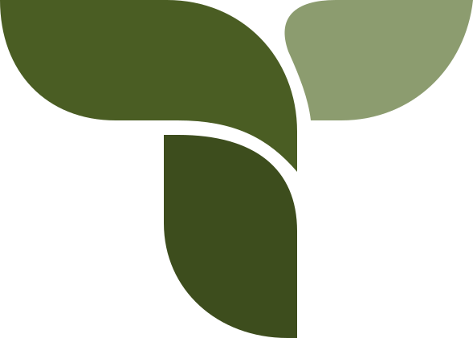
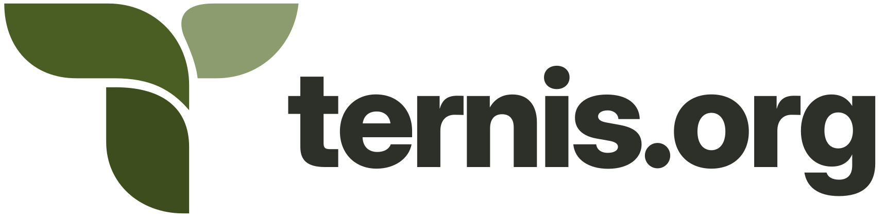

# ternis.org — Modern Open-Source Developer Ecosystem

<p align="center">
  <picture>
    <source media="(prefers-color-scheme: dark)" srcset="public/assets/brand/ternis-icon-dark.svg">
    <source media="(prefers-color-scheme: light)" srcset="public/assets/brand/ternis-icon-light.svg">
    
  </picture>
</p>

<p align="center">
  <picture>
    <source media="(prefers-color-scheme: dark)" srcset="public/assets/brand/ternis-wordmark-dark.svg">
    <source media="(prefers-color-scheme: light)" srcset="public/assets/brand/ternis-wordmark-light.svg">
    
  </picture>
</p>

<p align="center">
  <strong>Empowering Developers with Open, Sovereign & Fast Digital Infrastructure.</strong><br>
  Maintained by <a href="https://ternis.dev">ternis.dev</a> &amp; backed by <a href="https://ternis-edv.de">ternis-edv.de</a>
</p>

<p align="center">
  <a href="https://github.com/ternis-org/ww1.ternis.org/blob/master/LICENSE"></a>
  <a href="https://php.net"></a>
  <a href="https://ternis.org/sitemap.xml"></a>
  <a href="https://ternis.org/api/ver"></a>
  <a href="https://ternis.org"></a>
</p>

---

## 🌐 Overview

**ternis.org** is the official open-source organization and digital sovereignty hub operated by **[ternis.dev](https://ternis.dev)** (the engineering portal of Fabian Ternis) and supported by **[ternis-edv.de](https://ternis-edv.de)** (a German web engineering and digital solutions studio).

ternis.org is dedicated to stewarding and scaling open-source developer tooling by **[MTEX.dev](https://mtex.dev)**, sovereign European communications platforms, and independent web infrastructure.

### Core Values
- 🛡️ **Free & Open-Source Tools:** We actively maintain and publish open-source developer tooling and public utilities under permissive licenses.
- 🇪🇺 **European Digital Sovereignty:** Strictly zero non-consensual telemetry, zero advertising trackers, and GDPR-compliant infrastructure hosted on European soil.
- ⚡ **Developer Ergonomics:** Predictable APIs, minimal runtime dependencies, and instant copy-paste developer tooling.

---

## 📦 Maintained Projects & Initiatives

```
                      ┌────────────────────────────────────────┐
                      │             FABIAN TERNIS              │
                      │         (Founder & Lead Eng)           │
                      └───────────────────┬────────────────────┘
                                          │
        ┌─────────────────────────────────┼─────────────────────────────────┐
        │                                 │                                 │
        ▼                                 ▼                                 ▼
┌──────────────────┐            ┌──────────────────┐            ┌──────────────────┐
│  ternis-edv.de   │            │    ternis.dev    │            │    ternis.org    │
│ (Commercial &    │            │ (Personal Hub &  │            │  (Open-Source &  │
│  Agency Studio)  │            │  Tech Portfolio) │            │  Community Fdn)  │
└──────────────────┘            └──────────────────┘            └─────────┬────────┘
                                                                          │
                        ┌─────────────────────────────────────────────────┴────────────────────────┐
                        │                                                                          │
                        ▼                                                                          ▼
            ┌───────────────────────┐                                                  ┌───────────────────────┐
            │   MTEX.dev Project    │                                                  │ Sovereign Infra & Web │
            │  (Developer Tooling)  │                                                  │  (DNS, Cloud & Mail)  │
            ├───────────────────────┤                                                  ├───────────────────────┤
            │ • getmy.name (API)    │                                                  │ • example-dns (NS)    │
            │ • API Sandbox Tools   │                                                  │ • drophtml.de (Host)  │
            │ • Tailwind Components │                                                  │ • mail-free.eu / .uk  │
            │ • static.re Pipeline  │                                                  │ • EU Privacy Services │
            └───────────────────────┘                                                  └───────────────────────┘
```

> **Note:** All domains listed are managed through **[dnbx.de](https://dnbx.de)** (by [ternis.dev](https://ternis.dev)) with ternis.org's own authoritative nameservers: `one.ns.ternis.net` (= `example-dns.net`) & `two.ns.ternis.net` (= `example-dns.org`). ternis.org owns `example-dns.com`, `example-dns.net`, and `example-dns.org`.

### 1. [httpclient.de](https://httpclient.de) — Free HTTP Client for Web & Desktop
- **Status:** `Work in Progress (WIP)`
- **License:** Open Source & Free
- **Summary:** Free and open-source HTTP client available both in the web browser and as a lightweight native desktop application.

### 2. [api-sandbox.de](https://api-sandbox.de) — Simple API Viewer & Sandbox
- **Status:** `Partly Functional / Beta`
- **License:** Open Source & Free
- **Summary:** Free and open-source, minimalist API viewer designed for inspecting REST endpoints and schemas without friction.

### 3. [MTEX.dev](https://mtex.dev) — Developer Tools & Components
- **Status:** `Active Ecosystem`
- **License:** MIT
- **Summary:** Suite of free and open-source developer utilities and sandboxes, maintaining **[getmy.name](https://getmy.name)** (Free Headless Portfolio API).

### 4. [web-search.org](https://web-search.org) — Self-Hostable Search Engine
- **Status:** `Work in Progress (WIP)`
- **License:** Open Source & Free
- **Summary:** Lightweight, privacy-respecting, and simply self-hostable search engine focused on clean indexing without algorithmic bloat or tracking.

### 5. [mail-free.eu](https://mail-free.eu) + [mail-free.uk](https://mail-free.uk) — Auto-Generated Inboxes & Online Privacy
- **Status:** `In Development`
- **License:** Open Source & Free
- **Summary:** Free, open-source email generation and digital privacy relay platform protecting your personal inbox through auto-generated disposable email aliases.

### 6. [static.re](https://static.re) — S3 & Cloudflare R2 Storage Platform
- **Status:** `Platform & Open-Source Software`
- **License:** Open Source Software (with dedicated commercial tiers)
- **Summary:** Open-source software and managed distribution platform for interacting with S3-compatible object storage like Cloudflare R2.

### 7. [drophtml.de](https://drophtml.de) — Free Drag-and-Drop HTML & Website Host
- **Status:** `Free Developer Service`
- **License:** Free & Open Source
- **Summary:** Free and zero-configuration web platform to publish static HTML files and websites instantly via drag-and-drop.

### 8. [example-dns](https://example-dns.com) — Authoritative Nameservers & Open-Source DNS Infrastructure
- **Status:** `Active Infrastructure & Open-Source Project`
- **License:** Open Source & Free
- **Nameservers:** `one.ns.ternis.net` (= `example-dns.net`) & `two.ns.ternis.net` (= `example-dns.org`)
- **Domains Owned:** `example-dns.com`, `example-dns.net`, `example-dns.org`
- **Repositories:** [GitHub (github.com/example-dns/example-dns)](https://github.com/example-dns/example-dns) &bull; [Codeberg (codeberg.org/example-dns/example-dns)](https://codeberg.org/example-dns/example-dns)
- **Summary:** Authoritative nameservers and open-source DNS infrastructure owned and operated directly by ternis.org for transparent, sovereign digital services.

---

## 🛠️ Architecture & Features

This website is designed for maximum speed, digital sustainability, and developer ergonomics:

- 🚀 **Zero Heavy Frameworks:** Ultra-fast custom PHP micro-router with sub-millisecond execution overhead.
- 🌍 **Full Bilingual i18n:** Built-in English (`/en`) and German (`/de`) language matrices with automatic browser `Accept-Language` detection.
- 🌿 **Organic Green Tech Design System:**
  - Distinctive organic olive & sage palette (`#4a5d23`, `#8c9c6f`, `#f7f6f2`, `#d4a373`) + dark mode companion.
  - Floating pill navigation bar (`backdrop-filter: blur(16px)`) with sticky breadcrumb pills pinned beneath it.
  - Morphing SVG ambient blobs and noise grain texture overlay.
  - Initial micro-loader animation with `sessionStorage` caching.
  - Sculpted curved organic footer with a four-column link grid.
- ⚡ **Dynamic Scroll & Motion System:** Fluid step-by-step project card side entrance, bidirectional reversible animations on scroll-up, and native IntersectionObserver tracking — reveal targets are pre-hidden before first paint (with a fail-open timer), so content never flashes and headers can never vanish on load.
- 🌱 **Brand Load-in:** The inline SVG logo "unfolds" on first visit — stem grows, leaves pop, and the wordmark letters cascade in; fully skipped when `prefers-reduced-motion` is set.
- 🔒 **Security & Privacy by Default:**
  - Strict Content Security Policy and security headers (`X-Content-Type-Options`, `X-Frame-Options`, `Referrer-Policy`).
  - Traversal-protected static file delivery engine.
  - Zero cookies, zero tracking scripts, zero third-party analytics.
  - Browser-facing tools query through same-origin API proxies instead of third-party endpoints.
- 📲 **Progressive Web App (PWA):** Service Worker (`/sw.js`) with stale-while-revalidate caching.
- 🤖 **Developer & Crawler Endpoints:**
  - `/api/ver` — JSON & Plaintext version hash endpoint.
  - `/sitemap.xml` — Dynamic XML sitemap with multi-language hreflang alternates.
  - `/robots.txt` — Search engine directive.

---

## 🧰 Built-in Developer Tools

Free, one-page utilities at `/en/tools` (also available in German). No signup, no storage — most results never leave your browser:

| Tool | Route | Description |
| ---- | ----- | ----------- |
| **Shortlink & QR Studio** | [`/en/tools/shortlink`](https://ternis.org/en/tools/shortlink) | Design short URLs and QR codes with a full [API guide](https://ternis.org/en/tools/shortlink/api). |
| **Live DNS Looking Glass** | [`/en/tools/dns`](https://ternis.org/en/tools/dns) | Query A/AAAA/MX/TXT/NS/SOA/CNAME records via DoH, with a privacy-first server proxy fallback. |
| **Token & Secret Generator** | [`/en/tools/secret-generator`](https://ternis.org/en/tools/secret-generator) | Cryptographically secure API keys, passwords and tokens from refreshed `random_bytes()` entropy. |
| **One-Shot UUID Generator** | [`/en/tools/uuid`](https://ternis.org/en/tools/uuid) | Copy-to-burn UUIDv4: each value can be copied exactly once, then it is gone. |
| **WHOIS & RDAP Explorer** | [`/en/tools/whois`](https://ternis.org/en/tools/whois) | Privacy-first RDAP domain lookups proxied server-side, so your IP never touches the registry. |

The same tools are also exposed programmatically: `POST /api/tools/shortlink`, `GET /api/tools/dns` and `GET /api/tools/whois`.

---

## 📁 Repository Structure

```
ww1.ternis.org/
├── assets/                    # Static assets (CSS, JS) — synced copies for tooling
│   ├── css/
│   │   ├── app.css            # Organic tech design system
│   │   └── wiki.css           # Fully separated wiki stylesheet (wiki pages only)
│   └── js/
│       ├── app.js             # Motion engine, theme switcher & interactions
│       └── wiki.js            # Fully separated wiki script: search + copy (wiki pages only)
├── bootstrap.php              # Core application bootstrap & route definitions (incl. tools & API proxies)
├── index.php                  # Root front-controller delegate
├── lang/                      # Localization dictionaries
│   ├── de.php                 # German translations
│   └── en.php                 # English translations
├── public/                    # Document root
│   ├── .htaccess              # Apache/LiteSpeed rewrite rules
│   ├── apple-touch-icon.png   # iOS/macOS icon
│   ├── favicon.ico            # Binary multi-res favicon
│   ├── favicon.svg            # Vector icon
│   ├── index.php              # Primary HTTP entry point
│   ├── manifest.json          # Web app manifest
│   ├── og.jpg / og.png        # OpenGraph social cards
│   ├── sitemap.xsl            # Stylesheet for the XML sitemap
│   ├── sw.js                  # Service Worker
│   └── assets/                # Served assets (canonical versions of assets/)
│       ├── brand/             # Official brand kit: logos, one-color variants, editable wordmarks, ZIP
│       ├── css/               # app.css, brand.css, tools.css, wiki.css
│       └── js/                # app.js, wiki.js
├── src/                       # Core PHP backend
│   ├── helpers.php            # Global helpers (e, t, render, asset_url)
│   ├── router.php             # Lightweight URL router
│   ├── wiki.php               # Wiki engine (flat-file Markdown, search, index)
│   └── views/                 # View templates
│       ├── branding.php       # Brand kit showcase page (/en/branding)
│       ├── components/        # Reusable pieces (brand SVG, navbar, footer, scroll-to-top)
│       ├── error.php          # 404 / 500 error page
│       ├── index.php          # Main homepage view
│       ├── infrastructure.php # Sovereign infrastructure overview
│       ├── legal.php          # Impressum, Privacy & License view
│       ├── project_detail.php # Single-project page
│       ├── projects.php       # Maintained projects overview
│       ├── sitemap.php        # Dynamic XML sitemap (incl. wiki URLs)
│       ├── tools/             # Developer tool views (shortlink, dns, secret_generator, uuid, whois)
│       ├── wiki/              # Wiki views (home, category, article, search, feed)
│       └── layouts/           # main.php (site) & wiki.php (wiki) base layouts
├── content/
│   └── wiki/                  # Wiki articles (Markdown + frontmatter)
│       ├── en/{category}/{slug}.md
│       └── de/{category}/{slug}.md
├── static/
│   └── robots.txt             # Robots exclusion standard
└── README.md                  # Project documentation
```

---

## 🚀 Quick Start & Local Development

### Prerequisites
- **PHP 8.1+** (PHP 8.2 or 8.3 recommended)
- **Git**

### Running the Development Server

1. **Clone the repository:**
   ```bash
   git clone https://github.com/ternis-org/ww1.ternis.org.git
   cd ww1.ternis.org
   ```

2. **Start the PHP built-in web server:**
   ```bash
   php -S 127.0.0.1:8000 public/index.php
   ```

3. **Open in your browser:**
   ```
   http://127.0.0.1:8000
   ```
   The application will automatically detect your browser's preferred language and redirect to `/en` or `/de`.

---

## 🐳 Docker Deployment

You can run the application with Docker and Docker Compose:

```yaml
version: '3.8'
services:
  ternis-web:
    image: php:8.3-apache
    container_name: ternis_org
    restart: unless-stopped
    ports:
      - "8080:80"
    volumes:
      - .:/var/www/html
    environment:
      - APACHE_DOCUMENT_ROOT=/var/www/html/public
```

---

## 🤝 Contributing

Contributions to `ternis.org` and any of our maintained ecosystem projects are warmly welcome!

1. Fork the repository on GitHub.
2. Create your feature branch (`git checkout -b feature/amazing-feature`).
3. Commit your changes (`git commit -m 'feat: add amazing feature'`).
4. Push to the branch (`git push origin feature/amazing-feature`).
5. Open a Pull Request.

---

## ⚖️ License & Credits

- **Software License:** Distributed under the permissive **[MIT License](LICENSE)**.
- **Maintained By:** **[Fabian Ternis](https://ternis.dev)** ([ternis-edv.de](https://ternis-edv.de))
- **Ecosystem:** [ternis.org](https://ternis.org) • [mtex.dev](https://mtex.dev) • [getmy.name](https://getmy.name) • [mail-free.eu](https://mail-free.eu) • [static.re](https://static.re)

## 🎨 Ternis.org Logo & Brand assets

The logo shown at the top of this README is the official icon + wordmark from
the brand kit, switching light/dark with GitHub's color scheme via
`prefers-color-scheme`. The full kit lives in `public/assets/brand/`.

Visit `/en/branding` or `/de/branding` for logo previews, SVG downloads, colors,
and usage guidance. The full source kit is available as
`public/assets/brand/ternis-brand.zip`; editable wordmarks require Inter Display
ExtraBold, while outlined SVGs need no fonts.

Brand sources are supplied locally in `.local/ternis-brand-final/` (ignored by
Git). When refreshing the brand, copy the updated SVGs to `public/assets/brand/`,
rebuild the ZIP, and regenerate the root favicon, touch/PWA icons, and social
cards from those sources. Raster icons use a cream background with padding;
the maskable icon keeps the mark within the central safe area. The separate
wiki layout and article card generator retain their existing design.
